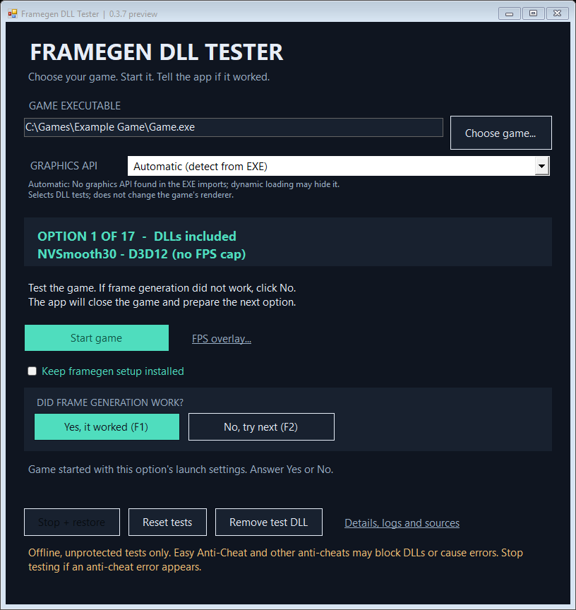

# Framegen DLL Tester

**Choose a game EXE, start the game, and test the included frame-generation DLLs.** The app handles the launch settings, backups, next attempt and restoration. You do not need to choose a candidate DLL, rename files or edit a batch file.

**Version 0.3.7 preview · Windows x64 · .NET Framework 4.8**

[**Release v0.3.7**](https://github.com/maiki74/NVSmooth30-External-Framegen/releases/tag/v0.3.7) · [**Download EXE**](https://github.com/maiki74/NVSmooth30-External-Framegen/releases/download/v0.3.7/FramegenDllTester.exe) · [**Portable ZIP**](https://github.com/maiki74/NVSmooth30-External-Framegen/releases/download/v0.3.7/FramegenDllTester-Portable-v0.3.7.zip) · [**Source-code ZIP**](https://github.com/maiki74/NVSmooth30-External-Framegen/releases/download/v0.3.7/FramegenDllTester-Source-v0.3.7.zip) · [Checksums](https://github.com/maiki74/NVSmooth30-External-Framegen/releases/download/v0.3.7/SHA256SUMS.txt)

> **Online games and anti-cheat:** Easy Anti-Cheat and other systems that inspect DLLs may block a test, cause startup errors or create account risk. Use offline, unprotected sessions. If an anti-cheat error appears, stop testing and restore the original files. This app does not bypass anti-cheat or guarantee online compatibility.



## How to use

1. Open **FramegenDllTester.exe**. The ZIP contains the EXE at its root; a repository checkout stores it under `downloads/`.
2. Click **Choose game...** and select the game's x64 executable. Recognized Unreal launchers are resolved to their actual renderer automatically.
3. Leave **Automatic** selected and click **Start game**. The app prepares the matching test and starts the game with its settings.
4. Enter gameplay and judge whether frame generation works and the image is smoother.
5. Press **F1 / Yes, it worked** to save the choice. Press **F2 / No, try next** to request a graceful game close, restore the previous files and prepare the next available option. Click **Start game** again to test it.

Opening the game or loading a DLL alone does not prove frame generation. **Yes** records your observation, not an independently measured FPS multiplier.

## Controls

| Control | What it does |
| --- | --- |
| **Start game / Start saved setup** | Applies the selected or saved setup and launches the game. |
| **Yes / F1** | Saves the working option without interrupting play. |
| **No / F2** | Closes the game gracefully, restores files and prepares the next option; a one-option route ends its sequence. |
| **Stop + restore** | Ends the test and restores tracked original files. |
| **Reset tests** | Restores files, clears the saved choice and returns to option 1 while retaining history. |
| **Remove test DLL** | Removes all tracked test DLL / ASI / configuration files, restores originals and disables persistent setup. Unrelated game DLLs are preserved. |
| **Keep framegen setup installed** | Optional persistent installation for compatible DX11 / DX12 routes; disabled by default. |
| **Details, logs and sources** | Shows the current diagnosis, logs, origins and notices. |

F1 / F2 are global while an answer is expected, including with the game focused. They are released during file operations and on app exit. A key already reserved by another app may require using the buttons. Persistent setups also accept Yes / No; rejecting one restores it before installing the next option.

The app never force-terminates a game. Resolve a save prompt or close an unresponsive game yourself before restoration can finish.

## Graphics compatibility

| Detected API | Included test route |
| --- | --- |
| **DirectX 9** | Experimental official DXVK 3.1.1 x64 translation to Vulkan, followed by the embedded NVSmooth30 Vulkan adapter. |
| **DirectX 11** | Original NVSmooth30 image through Ultimate ASI Loader: `dinput8.dll`, `xinput1_3.dll` or `winmm.dll`. |
| **DirectX 12** | Existing prepared NVSmooth30 and DLSSG for SM86 snapshot options. DLSSG still requires the game's applicable DLSS Frame Generation support / settings. |
| **Vulkan** | Experimental embedded Vulkan adapter, enabled only for the launched process tree. |
| **DirectX 10 / OpenGL** | No compatible backend in this package. |

**Automatic** uses executable imports, distinguishes direct and delayed imports, reads recognized Unreal launcher resources, and uses bounded recent matching game logs where available. Packed Godot metadata is inspected without executing the game. These are detection hints; dynamic loading and a different launch configuration can change the actual renderer.

Manual **DirectX 12 / DirectX 11 / Vulkan** selects the test route; it does not force the game's renderer. Changing the selection restores the current attempt and resets the sequence. DX9 translation is a separate automatic route that translates the game's calls into Vulkan.

Compatibility depends on the game, its other mods and the driver. **This is not a guarantee for every game.** The experimental Vulkan routes require the exact locally verified NVIDIA driver binaries; a mismatch is rejected before launch. See [requirements and exact hashes](docs/VULKAN.md).

## Outlast fix and reported results

The owner tested **Outlast** with app 0.3.6 and reported that it **opened and felt smoother**. The trial recorded DXVK presentation, a normal exit and restoration of the staged DLL. Version 0.3.7 retains that launch logic and adds publication labels, documentation and packaging.

The fix has two parts:

- Outlast's matched UE3 log identifies **DX9**. Its delayed DX11 import must not replace that evidence, including after an incomplete startup log.
- The DX9 route stages verified DXVK `d3d9.dll` and applies a child-only workaround for a reproduced conflict with **RTSS's Vulkan layer**. RTSS stays running and its saved settings are unchanged; overlay availability still needs a gameplay check.

Buckshot Roulette also has positive owner feedback after 0.3.2. Dark Souls Remastered has a reported 120 FPS counter alongside a bridge error, so its generated-frame result remains unresolved. Stray has no confirmed successful gameplay result in this app. See the [gameplay feedback table](docs/TESTED-GAMES.md).

Visual feedback does not establish an exact generated-frame count, latency improvement or compatibility with other installations.

## Steam and persistent setup

Steam is not required for all games. For recognized installed Steam games, the app reads the matching local library manifest, supplies the real App ID to the launched process and starts the Steam client if needed. Normal ownership and login requirements still apply. Steam API files and global Steam launch options are unchanged.

**Keep framegen setup installed** is optional for the compatible DX11 / DX12 routes. It retains tracked files for normal launches with the tester closed. Turn it off or use **Remove test DLL** to restore the originals.

**Native Vulkan and DX9 -> Vulkan must be launched from this app.** They depend on process-local settings and do not offer persistent normal-launch installation. Starting the game directly from Steam does not apply those settings.

## FPS settings and overlay

The launch profiles impose **no mod FPS cap and no forced VSync**. The old batch-file 30 FPS cap is not used. A game or driver can still have its own limits.

Vulkan v2 can replace FIFO presentation with supported IMMEDIATE presentation for eligible swapchains in that launch, potentially allowing tearing. It does not rewrite saved game settings; unknown extension chains pass through unchanged.

**FPS overlay...** optionally configures an existing RTSS installation to show PresentMon displayed FPS. It updates once per second, preserves the original application-frametime graph and supports restoring the original layout. No fixed doubling is applied. Displayed FPS and source/application FPS are different measurements; telemetry availability depends on the presentation path.

## Backups and recovery

Local settings, saved choices, journals, extracted assets and original-file backups are kept under:

```text
%LOCALAPPDATA%\Framegen DLL Tester
```

Files are backed up before staging and restored after a normal test ends. An explicitly enabled persistent setup remains installed when the app closes. If a test is interrupted, reopen the tester and choose **Restore interrupted test**. Keep the backups until restoration succeeds. Runtime modifications to tracked files are preserved separately; unrelated DLLs and new mod logs are not deleted.

## Verification and build

The current logic passes **170 automated checks** covering control states, hotkeys, launchers, API evidence, staging, restoration and recovery. Separate disposable DX9 presentation fixtures reproduce the RTSS conflict and verify the child-only workaround. Those fixtures do not prove generated frames in a real game. See [verification](docs/VERIFICATION.md) and [published check output](docs/AUTOMATED-CHECKS.txt).

The repository includes the original C# source, native C adapter, tests and packaging scripts. To rebuild the supplied snapshot using Windows PowerShell 5.1 and .NET Framework 4.8:

```powershell
# PowerShell 5.1 · repository root · Windows x64 / .NET Framework 4.8
.\tools\Extract-BuildInputs.ps1
.\build.ps1 -Test
```

The extraction script verifies the published EXE checksum and reads its embedded build inputs. It does not run the app's Main method or execute the native backends. See [native adapter source / build](native/vulkan/README.md) and [sources](docs/SOURCES.md) for versions, hashes and the local packer.

## Authors, sources and licenses

- **maiki74:** product direction and gameplay testing.
- **OpenAI Codex:** original tester UI, controller, native Vulkan adapter and integration under the owner's direction.
- **ItsAdeline / [NVSmooth30](https://github.com/ItsAdeline/NVSmooth30):** existing frame-generation backend. Its original MIT notice is retained; the previously prepared binary and recovered original image have separate hashes.
- **sdli1995 / [DLSSG for SM86](https://github.com/sdli1995/dlssg_for_sm86):** the owner's existing 0.3.5 / 310.9 and 310.1 package snapshot. Supplied snapshot notices are preserved separately from newer upstream versions.
- **ThirteenAG / [Ultimate ASI Loader](https://github.com/ThirteenAG/Ultimate-ASI-Loader):** official v10.0.0 x64 loader, MIT.
- **doitsujin and contributors / [DXVK](https://github.com/doitsujin/dxvk/releases/tag/v3.1.1):** official unmodified 3.1.1 x64 DX9 translator, zlib/libpng license.
- **Khronos / [Vulkan-Headers](https://github.com/KhronosGroup/Vulkan-Headers/tree/v1.4.351):** native API declarations, Apache-2.0 OR MIT.
- **Unwinder / RTSS and Intel [PresentMon](https://github.com/GameTechDev/PresentMon):** existing installed overlay / presentation telemetry; their binaries are not repackaged.
- **Microsoft:** Windows, DirectX and .NET APIs. **NVIDIA:** driver, NvPresent and frame-generation technology; installed driver DLLs are not distributed by this app.

The app's original code uses the [MIT license](LICENSE). Third-party binaries and derived kernel material retain their own rights and terms. Full notices, exact hashes, the scope of the earlier binary patch and provenance are documented in [THIRD_PARTY_NOTICES.md](THIRD_PARTY_NOTICES.md) and [docs/SOURCES.md](docs/SOURCES.md).
